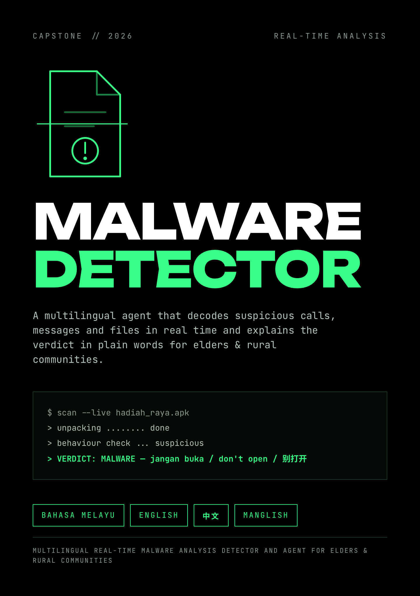

# 🛡️ CYPHER DECODE ASEAN



A prototype built for the Meta AI Global Developer Hackathon 2026 - Startup Track

**Languages:** Bahasa Malaysia · English · 中文 · Manglish  

**Channels:** chat · voice-style · phone alert

**Target Country:** Malaysia · Singapore · Indonesia · Brunei Darussalam

---

## 😟 The problem

| | |
|---|---|
| **Up to 80%** | of scam cases in some ASEAN member states involve calls and SMS |
| **63%** | of adults in the region met a scam in the past year; phone calls were the top channel |
| **USD 23.6 B** | estimated regional losses in 2024 |

Elders are hit hardest by phishing and investment scams, often over the phone, and rural communities have the least tech support. The ASEAN Guide tells telcos and governments what to do at the network level. **Nobody is standing next to the grandmother when the "police" call.**

<sub>Source: ASEAN Guide on Anti-Scam Policies and Best Practices, Jan 2026, pp.6, 15, 19.</sub>

## 💡 The idea

Agent decodes, scans and block what just happened. Get a straight answer in easy words, and three steps:

> ### ✋ Stop · 🔎 Check · 📣 Report and block

No jargon. No blame. And it **never says "100% safe"**.

## 🎬 See it work

These are real outputs from the prototype.

**1. Manglish: a fake police call**

```
You:  Eh you got call from police ah, they say your account got problem, must transfer money lah

Bot:  This one looks like a scam, ah.
      They say they are police, court or government office.
      They ask you pay or transfer money.
      1. Stop first. Don't click, reply, pay or give any number.
      2. Check. Call your bank using the number at the back of your card, or ask your family.
      3. Report and block. Tell the official scam hotline, then block the number.
      4. Official hotline: National Scam Response Centre (NSRC), 997.
```

**2. Bahasa Malaysia, voice style: a "prize" with an app file**

```
You:  Tahniah! Anda menang RM5000. Muat turun app di http://hadiah-menang.top/win.apk

Bot:  Ini nampak seperti penipuan. Ia suruh pasang fail aplikasi. Aplikasi palsu boleh curi
      maklumat bank anda. Ia kata anda menang hadiah yang anda tak sertai. Berhenti. Jangan klik,
      balas, bayar atau bagi sebarang nombor. Semak. Telefon bank anda ...
```

**3. 中文: a fake police transfer request**

```
You:  我是警察，请立即转账到安全账户

Bot:  这看起来是诈骗。
      警察和银行不会叫你把钱转到安全账户。
      ...
```

## ⚙️ How it works

```
 message / call story / link ──► language detect ──► scam-signal triage ──► verdict
                                                          │                   │
        OTP asks · "safe account" · police + money        │            RED · AMBER · GREEN-ish · UNSURE
        fake bank links · shortened links · .apk          ▼                   │
        prize · investment · job · confirmed blocklist  reasons ──► easy-language reply
                                                                     + Stop · Check · Report
                                                                     + official hotline
```

## ✅ What's built vs what's next

| Built in this hackathon | Next |
|---|---|
| Rule-based triage with plain-language reasons | LLM agent with tool calls, using the included system prompt |
| 4-language replies, voice-style mode, hotline by country | Real speech in and out |
| "Already scammed" emergency guidance (in the system prompt) | Phone-alert mock-up and pilot |
| 18 unit tests (/data/samples/test_case.jsonl), sample evaluation, CI, Docker | Larger test set; review by native speakers |

## 🧭 Why it fits the ASEAN Guide

- Targets the **call to action** stage, where the Guide says interruption matters (p.12).
- Follows the Guide's **public education and reporting** measures: warn before the point of action, give a reporting route (Ch.7, pp.70-72).
- Reuses the Philippine public campaign's routine, **Identify, Ignore, Report, Block** (p.70), as Stop, Check, Report and block.
- Honest about scope: the Guide covers telco calls and SMS and is written for governments and telcos. This is a user-side tool, not a telco control. Mapping: [`/asean-alignment.md`](docs/asean-alignment.md).

## 🚀 Run it in 30 seconds

No installs. Python 3.9+.

```bash
git clone https://github.com/<SoniaSherlina77>/scam-helper-asean.git && cd scam-helper-asean
export PYTHONPATH=src        # Windows PowerShell: $env:PYTHONPATH="src"

python -m scamhelper.cli check "Ada orang call kata dari polis, suruh transfer duit ke akaun selamat."
python -m scamhelper.cli check "Maybank: account locked. Verify at http://maybank2u-secure-login.xyz" --voice
python -m unittest discover -s tests      # 18 tests
```

## ⚠️ Honest limits

- **Not a fully malware analyzer.** It never opens links or files. It checks names, types and link patterns only.
- **Rule-based baseline.** It can flag new scams and detect genuine messages. The 16-case sample set is synthetic: a smoke test, not an accuracy claim.
- **Unverified data.** Hotline numbers and the official-domain list in `data/` must be confirmed before real use.
- **Wording is a first draft** and needs review by native speakers. **No real-user testing yet.**
- Not an official ASEAN, government, telco or bank product.

## 📚 More

[Objectives](docs/objectives.md) · [Architecture](docs/architecture.md) · [Ethics and safety](docs/ethics-and-safety.md) · [System prompt](docs/system_instructions.md) · [ASEAN Alignment](docs/asean-alignment.md)

MIT licence. 
